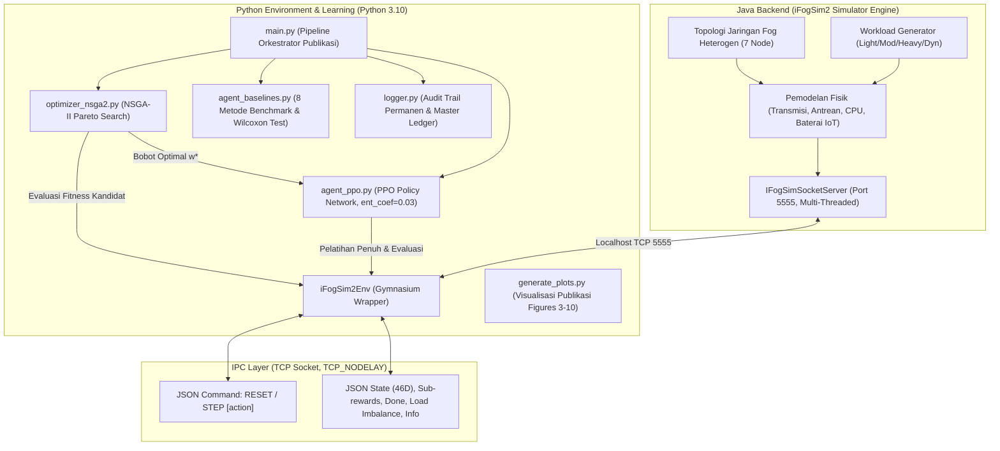

# ERWO-PPO: Evolutionary Reward Weight Optimization for iFogSim2 Task Offloading

Kerangka kerja riset terintegrasi yang menggabungkan **Multi-Objective Evolutionary Algorithm (NSGA-II)** dengan **Deep Reinforcement Learning (PPO)** untuk mengotomatisasi pencarian bobot reward optimal (*Evolutionary Reward Weight Optimization / ERWO*) pada simulasi penempatan tugas (*task offloading*) di lingkungan **iFogSim2**.

---

## 📑 Daftar Isi

1. [Latar Belakang & Motivasi Riset](#1-latar-belakang--motivasi-riset)
2. [Arsitektur Sistem End-to-End](#2-arsitektur-sistem-end-to-end)
3. [Formulasi Matematis & Markov Decision Process (MDP)](#3-formulasi-matematis--markov-decision-process-mdp)
   - [Ruang Observasi (46 Dimensi)](#a-ruang-observasi-46-dimensi)
   - [Ruang Aksi (Discrete 7)](#b-ruang-aksi-discrete-7)
   - [Skema 4 Sub-Reward Multi-Objektif](#c-skema-4-sub-reward-multi-objektif)
4. [Rincian Komponen & Struktur Direktori](#4-rincian-komponen--struktur-direktori)
5. [📖 Tutorial Walkthrough & Langkah Reproduksi Lengkap](#5--tutorial-walkthrough--langkah-reproduksi-lengkap)
   - [Langkah 1: Persiapan Environment Python (3.10)](#langkah-1-persiapan-environment-python-310)
   - [Langkah 2: Kompilasi & Menjalankan Server Java iFogSim2](#langkah-2-kompilasi--menjalankan-server-java-ifogsim2)
   - [Langkah 3: Menjalankan Benchmark Lengkap 8 Metode](#langkah-3-menjalankan-benchmark-lengkap-8-metode)
   - [Langkah 4: Menghasilkan Visualisasi Grafik Ilmiah (Figures 3 s/d 10)](#langkah-4-menghasilkan-visualisasi-grafik-ilmiah-figures-3-sd-10)
   - [Langkah 5: Memeriksa Hasil Data & Laporan Audit](#langkah-5-memeriksa-hasil-data--laporan-audit)
   - [Langkah 6: Visualisasi Real-Time & Live Web Dashboard](#langkah-6-visualisasi-real-time--live-web-dashboard)
6. [Opsi Argumen Baris Perintah (CLI Options)](#6-opsi-argumen-baris-perintah-cli-options)
7. [Protokol Komunikasi Inter-Process (TCP Socket IPC)](#7-protokol-komunikasi-inter-process-tcp-socket-ipc)
8. [Struktur Laporan & Hasil Publikasi (Data.md & report.md)](#8-struktur-laporan--hasil-publikasi-datamd--reportmd)

---

## 1. Latar Belakang & Motivasi Riset

Pada komputasi Fog/Edge (*Fog Computing*), keputusan *task offloading* harus menyeimbangkan berbagai tujuan yang saling bertentangan (*conflicting objectives*), seperti **meminimalkan latensi**, **menghemat energi baterai perangkat IoT**, **mencegah pelanggaran deadline (SLA)**, dan **memaksimalkan Quality of Service (QoS)**.

Pendekatan Reinforcement Learning konvensional umumnya menggabungkan tujuan-tujuan ini menjadi fungsi reward skalar menggunakan bobot manual (*scalarized reward*):

$$R = \alpha \cdot r_{\text{latency}} + \beta \cdot r_{\text{energy}} + \lambda \cdot r_{\text{deadline}} + \gamma \cdot r_{\text{qos}}$$

Namun, menentukan kombinasi bobot $[\alpha, \beta, \lambda, \gamma]$ secara manual (*trial-and-error*) sangat tidak efisien, subjektif, dan rentan menghasilkan kebijakan suboptimal. 

**Solusi ERWO-PPO**:
Menggunakan algoritma genetika multi-objektif **NSGA-II** (*Non-dominated Sorting Genetic Algorithm II*) untuk mengeksplorasi ruang pencarian bobot reward secara otomatis, menghasilkan **Pareto Front** yang optimal, lalu melatih agen **PPO** (*Proximal Policy Optimization*) pada bobot terbaik ($w^*$) untuk mengambil keputusan *offloading* adaptif secara *real-time*.

---

## 2. Arsitektur Sistem End-to-End

Sistem menghubungkan dua ekosistem berbeda (Java untuk simulasi fisik jaringan dan Python untuk algoritma AI) melalui protokol komunikasi **TCP Socket IPC**:



### Visualisasi Topologi 3-Tier & Konfigurasi Perangkat (Figure 1 & Table 6)


*Figure 1. Diagram arsitektur topologi jaringan hierarkis 3-Tier Fog-Cloud pada iFogSim2 (Node 0: IoT Gateway, Node 1-5: Fog Nodes, Node 6: Cloud Data Center).*

#### Table 6. Spesifikasi Konfigurasi Perangkat & Parameter Jaringan iFogSim2

| Node ID | Nama Perangkat | Tingkat (Tier) | CPU (MIPS) | RAM (GB) | Storage | Bandwidth | Latensi Link | Model Daya (Busy/Idle) | Aksi ($a_t$) |
|:---:|:---|:---:|:---:|:---:|:---:|:---:|:---:|:---:|:---:|
| **Node 0** | Local IoT Gateway | Tier 1 (IoT) | $1,200$ | $2\text{ GB}$ | $10\text{ GB}$ | $100\text{ Mbps}$ | $0.0\text{ ms}$ (Local) | Battery ($E = 1.25\times$) | $a = 0$ |
| **Node 1** | Fog Node A | Tier 2 (Fog) | $4,000$ | $8\text{ GB}$ | $100\text{ GB}$ | $1\text{ Gbps}$ | $15 - 35\text{ ms}$ | $107.33\text{ W} / 83.43\text{ W}$ | $a = 1$ |
| **Node 2** | Fog Node B | Tier 2 (Fog) | $4,000$ | $8\text{ GB}$ | $100\text{ GB}$ | $1\text{ Gbps}$ | $15 - 35\text{ ms}$ | $107.33\text{ W} / 83.43\text{ W}$ | $a = 2$ |
| **Node 3** | Fog Node C | Tier 2 (Fog) | $4,000$ | $8\text{ GB}$ | $100\text{ GB}$ | $1\text{ Gbps}$ | $15 - 35\text{ ms}$ | $107.33\text{ W} / 83.43\text{ W}$ | $a = 3$ |
| **Node 4** | Fog Node D | Tier 2 (Fog) | $4,000$ | $8\text{ GB}$ | $100\text{ GB}$ | $1\text{ Gbps}$ | $15 - 35\text{ ms}$ | $107.33\text{ W} / 83.43\text{ W}$ | $a = 4$ |
| **Node 5** | Fog Node E | Tier 2 (Fog) | $4,000$ | $8\text{ GB}$ | $100\text{ GB}$ | $1\text{ Gbps}$ | $15 - 35\text{ ms}$ | $107.33\text{ W} / 83.43\text{ W}$ | $a = 5$ |
| **Node 6** | Cloud Data Center | Tier 3 (Cloud) | $40,000$ | $64\text{ GB}$ | $10\text{ TB}$ | $10\text{ Gbps}$ | $65 - 85\text{ ms}$ (WAN) | $1600.0\text{ W} / 1200.0\text{ W}$ | $a = 6$ |

---

## 3. Formulasi Matematis & Markov Decision Process (MDP)

### A. Ruang Observasi (46 Dimensi)
State $s_t \in \mathbb{R}^{46}$ merepresentasikan kondisi jaringan, beban komputasi, dan karakteristik task baru pada saat $t$, ternormalisasi dalam rentang $[0.0, 1.0]$:

| Indeks Fitur | Deskripsi | Keterangan |
|---|---|---|
| `[0 : 7]` | **CPU Utilization** ($\mathbf{u}^{\text{cpu}}$) | Beban komputasi pada 7 node (Lokal, Fog 1-5, Cloud) |
| `[7 : 14]` | **RAM Availability** ($\mathbf{a}^{\text{ram}}$) | Ketersediaan memori pada 7 node |
| `[14 : 21]` | **Bandwidth Capacity** ($\mathbf{b}^{\text{net}}$) | Kapasitas throughput link komunikasi ke 7 node |
| `[21 : 28]` | **Network Latency** ($\mathbf{l}^{\text{net}}$) | Estimasi waktu propagasi & transmisi ke 7 node |
| `[28 : 35]` | **Queue Size** ($\mathbf{q}^{\text{len}}$) | Panjang antrean task yang menunggu pada 7 node |
| `[35 : 42]` | **Energy Consumption** ($\mathbf{e}^{\text{cur}}$) | Riwayat pemakaian daya listrik pada 7 node |
| `[42]` | **Task Data Size** ($d_{\text{task}}$) | Ukuran payload data tugas (KB/MB) |
| `[43]` | **Task Computation Length** ($c_{\text{task}}$) | Panjang instruksi komputasi (Million Instructions - MI) |
| `[44]` | **Task Deadline** ($T_{\text{deadline}}$) | Batas toleransi waktu penyelesaian task (ms/s) |
| `[45]` | **Task QoS Priority** ($p_{\text{qos}}$) | Tingkat prioritas layanan tugas (0.0 = Low, 1.0 = High) |

---

### B. Ruang Aksi (Discrete 7)
Aksi $a_t \in \{0, 1, 2, 3, 4, 5, 6\}$ menentukan node target tempat tugas akan dieksekusi:

- **Aksi `0`**: **Node Lokal** (*IoT End-Device*) — Latensi transfer 0, namun kapasitas CPU terbatas ($1.6\times$ lambat) dan konsumsi daya baterai tinggi ($1.25\times$).
- **Aksi `1 s/d 5`**: **Fog Nodes 1 s/d 5** (*Edge Servers*) — Komputasi responsif ($0.45\times$), transmisi nirkabel rendah ($0.25\times$), hemat daya baterai IoT.
- **Aksi `6`**: **Pusat Data Cloud** (*Cloud Server*) — Kapasitas CPU sangat tinggi ($0.10\times$), namun mengalami latensi WAN propagasi jarak jauh ($1.15\times$).

---

### C. Skema 4 Sub-Reward Multi-Objektif
Setiap langkah simulasi menghasilkan vektor sub-reward $\mathbf{r}_t = [r_{\text{latency}}, r_{\text{energy}}, r_{\text{deadline}}, r_{\text{qos}}]$:

1. **Sub-Reward Latensi ($r_{\text{latency}}$)**:
   $$T_{\text{total}} = T_{\text{trans}} + T_{\text{queue}} + T_{\text{exec}}$$
   $$r_{\text{latency}} = \text{clip}\left(\exp(-1.3 \cdot T_{\text{total}}), 0.0, 1.0\right)$$

2. **Sub-Reward Efisiensi Energi ($r_{\text{energy}}$)**:
   $$r_{\text{energy}} = \text{clip}\left(1.0 - \frac{E_{\text{spent}}}{1.5}, 0.0, 1.0\right)$$

3. **Sub-Reward Pelanggaran Deadline ($r_{\text{deadline}}$)**:
   $$r_{\text{deadline}} = \begin{cases} 1.0, & \text{jika } T_{\text{total}} \le 1.35 \cdot T_{\text{deadline}} \\ 0.0, & \text{jika } T_{\text{total}} > 1.35 \cdot T_{\text{deadline}} \text{ (Violated)} \end{cases}$$

4. **Sub-Reward Kualitas Layanan ($r_{\text{qos}}$)**:
   $$Q_{\text{factor}} = (1.0 - q^{\text{len}}_{a_t}) \cdot (1.0 - u^{\text{cpu}}_{a_t})$$
   $$r_{\text{qos}} = \begin{cases} \text{clip}(0.65 \cdot Q_{\text{factor}} + 0.35 \cdot p_{\text{qos}}, 0.0, 1.0), & \text{jika tidak melanggar deadline} \\ \text{clip}(0.15 \cdot Q_{\text{factor}}, 0.0, 1.0), & \text{jika melanggar deadline} \end{cases}$$

**Fungsi Reward Total**:
$$R(s_t, a_t) = \alpha \cdot r_{\text{latency}} + \beta \cdot r_{\text{energy}} + \lambda \cdot r_{\text{deadline}} + \gamma \cdot r_{\text{qos}}$$
dengan kendala normalisasi $\alpha + \beta + \lambda + \gamma = 1.0$ dan $\alpha, \beta, \lambda, \gamma \ge 0.01$.

---

## 4. Rincian Komponen & Struktur Direktori

```text
c:/Projects/erwo_ppo_project/
├── main.py                  # Orkestrator eksekusi pipeline benchmark publikasi
├── optimizer_nsga2.py       # Algoritma genetika NSGA-II untuk pencarian bobot w*
├── agent_ppo.py             # Model PPO (Stable-Baselines3) dengan entropy bonus
├── agent_baselines.py       # 8 Metode baseline, paired seed protocol, & uji Wilcoxon
├── env_ifogsim2.py          # Gymnasium Environment wrapper via TCP Socket
├── generate_plots.py        # Skrip otomatis render Figures 3 s/d 10 (PNG/PDF 300 DPI)
├── logger.py                # Manager logging audit trail permanen & master ledger
├── Data.md                  # Tabel publikasi utama (Table 10 s/d Table 14)
├── report.md                # Laporan riset komprehensif (Metodologi, Grafik, Analisis)
├── requirements.txt         # Daftar pustaka Python yang dibutuhkan
├── figures/                 # Output grafik publikasi (Figures 3 s/d 10)
├── logs/                    # Direktori riwayat log eksperimen
│   ├── experiment_history.csv  # Master cumulative ledger seluruh eksperimen
│   └── experiments/            # Folder per run berstempel waktu
│       └── exp_YYYYMMDD_HHMMSS_<workload>/
└── ifogsim/                 # Source code iFogSim2 Simulator
    ├── src/org/fog/placement/IFogSimSocketServer.java # Server TCP Socket IPC Java
    ├── jars/                # Dependencies JAR CloudSim & iFogSim
    └── out/production/      # Compiled Java bytecode
```

---

## 5. 📖 Tutorial Walkthrough & Langkah Reproduksi Lengkap

Ikuti langkah-langkah di bawah ini untuk menjalankan ulang seluruh eksperimen dari awal hingga akhir:

### Langkah 1: Persiapan Environment Python (3.10)

Buka PowerShell / Terminal di direktori proyek:

```powershell
cd c:\Projects\erwo_ppo_project

# 1. Buat Virtual Environment Python 3.10
python -m venv .venv

# 2. Aktifkan Virtual Environment
.\.venv\Scripts\activate

# 3. Pasang semua dependensi
pip install -r requirements.txt
```

---

### Langkah 2: Kompilasi & Menjalankan Server Java iFogSim2

Buka **Terminal 1** khusus untuk proses Java:

```powershell
cd c:\Projects\erwo_ppo_project\ifogsim

# 1. Kompilasi Server Socket Java
javac -d out/production/iFogSim2 src/org/fog/placement/IFogSimSocketServer.java

# 2. Jalankan Server dengan alokasi memori RAM yang cukup
java -Xms2G -Xmx4G -cp "out/production/iFogSim2;jars/*" org.fog.placement.IFogSimSocketServer 5555
```

> **Tampilan Berhasil**: Terminal akan menampilkan pesan:  
> `[iFogSim2-Server] Server Socket aktif di port: 5555`  
> `[iFogSim2-Server] Realistic Edge/Fog/Cloud Engine Siap Melayani PPO`

---

### Langkah 3: Menjalankan Benchmark Lengkap 8 Metode

Buka **Terminal 2**, pastikan virtual environment aktif, lalu jalankan:

```powershell
cd c:\Projects\erwo_ppo_project
.\.venv\Scripts\activate

# Eksekusi pipeline benchmark skala publikasi (Default: n=30, 25k timesteps, NSGA-II 10/4)
python main.py --workload dynamic
```

**Alur yang dieksekusi secara otomatis oleh skrip**:
1. **Tahap 1**: NSGA-II mengevaluasi 40 kombinasi bobot untuk menemukan Pareto Front dan memilih $w^*$ terbaik (*Knee-Point*).
2. **Tahap 2**: Melatih 4 model RL (`ERWO-PPO`, `PPO-Equal`, `PPO-Manual`, `DQN-Equal`) selama $25.000$ timesteps.
3. **Tahap 3**: Mengevaluasi ke-8 metode benchmark pada $n=30$ episode berpasangan (*Paired Seed Protocol*: `seed 1000..1029`).
4. **Tahap 4**: Menghitung uji signifikansi statistik (*Wilcoxon Signed-Rank Test* & *Cohen's d Effect Size*).
5. **Tahap 5**: Mencatat durasi komputasi (*Computational Overhead*), menyimpan model PPO terlatih ke `models/ppo_ifogsim2_erwo.zip`, memperbarui master ledger di `logs/experiment_history.csv`, dan mengisi seluruh tabel di [**`Data.md`**](file:///c:/Projects/erwo_ppo_project/Data.md).

---

### Langkah 4: Menghasilkan Visualisasi Grafik Ilmiah (Figures 3 s/d 10)

Setelah pengujian di Langkah 3 selesai, jalankan generator grafik:

```powershell
python generate_plots.py
```

Skrip ini akan otomatis merender 8 gambar resolusi tinggi (PNG 300 DPI untuk tinjauan cepat dan PDF vektor untuk kompilasi LaTeX jurnal) ke dalam folder `figures/`:
- `figures/fig3_nsga2_convergence.png` (.pdf)
- `figures/fig4_pareto_front.png` (.pdf)
- `figures/fig5_cumulative_reward.png` (.pdf)
- `figures/fig6_latency_comparison.png` (.pdf)
- `figures/fig7_energy_comparison.png` (.pdf)
- `figures/fig8_violation_rate_comparison.png` (.pdf)
- `figures/fig9_load_imbalance_comparison.png` (.pdf)
- `figures/fig10_qos_satisfaction_comparison.png` (.pdf)

---

### Langkah 5: Memeriksa Hasil Data & Laporan Audit

1. **Tabel Data Publikasi**: Buka [**`Data.md`**](file:///c:/Projects/erwo_ppo_project/Data.md) untuk melihat data Tabel 10 s/d Tabel 14 yang terisi 100% rapi.
2. **Laporan Komprehensif Riset**: Buka [**`report.md`**](file:///c:/Projects/erwo_ppo_project/report.md) untuk membaca metodologi lengkap (Section 5.6–5.12), grafik Figures 3–10 yang tertanam, riwayat Trial 1–3, dan narasi pembahasan akademik.
3. **Audit Trail Mentah**: Periksa folder `logs/experiments/exp_.../` untuk file data mentah per episode `benchmark_episodes.csv` atau uji statistik `statistical_tests.json`.

---

### Langkah 6: Visualisasi Real-Time & Live Web Dashboard

Proyek ini menyediakan antarmuka visualisasi web interaktif berbasis **FastAPI**, **WebSocket**, **Vis.js**, dan **Chart.js** untuk melihat proses offloading secara langsung:

#### 1. Menjalankan Server Dashboard:
```powershell
# Buka Terminal dan jalankan:
python run_dashboard.py
```
Buka browser di: [**http://127.0.0.1:8000**](http://127.0.0.1:8000)

#### 2. Menjalankan Simulasi (Dua Pilihan):
- **Opsi A (Langsung dari Web UI)**: Klik tombol **Run (▶)** di toolbar halaman dashboard. Anda dapat mengatur delay step (30–600 ms), memilih metode (`ERWO-PPO`, `Least-loaded fog`, `Nearest-fog`, dll.), menjeda (Pause), atau me-reset simulasi langsung dari browser.
- **Opsi B (Via CLI Demo Playback)**: Buka terminal baru dan jalankan skrip demo:
  ```powershell
  python run_demo.py --method ERWO-PPO --workload dynamic --delay 0.12
  ```
  Data telemetri akan disiarkan secara real-time ke web dashboard.

---

## 6. Opsi Argumen Baris Perintah (CLI Options)

Skrip `main.py` mendukung berbagai parameter kustomisasi fleksibel:

```powershell
# Contoh 1: Pengujian pada Beban Ringan (Light Workload)
python main.py --workload light

# Contoh 2: Pengujian pada Beban Padat / Stress Test (Heavy Workload)
python main.py --workload heavy

# Contoh 3: Eksplorasi Skala Besar (NSGA-II Pop 20, Gen 15, Eval 50 Episode)
python main.py --workload dynamic --pop-size 20 --generations 15 --eval-episodes 50 --final-timesteps 50000 --tag "large_scale_exp"
```

| Argumen | Tipe | Nilai Default | Keterangan |
|---|:---:|:---:|---|
| `--workload` | `str` | `dynamic` | Pilihan beban simulasi: `light`, `moderate`, `heavy`, `dynamic` |
| `--pop-size` | `int` | `10` | Ukuran populasi kromosom NSGA-II |
| `--generations` | `int` | `4` | Jumlah generasi iterasi evolusi NSGA-II |
| `--final-timesteps` | `int` | `25000` | Jumlah timesteps pelatihan model RL utama |
| `--eval-episodes` | `int` | `30` | Jumlah episode evaluasi berpasangan ($n$) |
| `--tag` | `str` | `None` | Label identifikasi khusus untuk folder log eksperimen |

---

## 7. Protokol Komunikasi Inter-Process (TCP Socket IPC)

Komunikasi antara Python dan Java berjalan melalui pertukaran string teks berbasis baris JSON:

1. **Perintah `RESET`**:
   - *Format Kirim*: `RESET <workload> <seed>\n`
   - *Format Balasan*: `{"status":"ok", "obs":[0.24, ..., 0.51], "step":0, "workload":"dynamic"}\n`
2. **Perintah `STEP`**:
   - *Format Kirim*: `STEP <action_int>\n`
   - *Format Balasan*: `{"status":"ok", "obs":[...], "sub_rewards":[r1, r2, r3, r4], "total_latency":..., "energy_spent":..., "load_imbalance":..., "is_violated":bool, "done":bool, "truncated":bool}\n`
3. **Perintah `CLOSE`**:
   - *Format Kirim*: `CLOSE\n`
   - *Format Balasan*: `CLOSE_ACK\n`

---

## 8. Struktur Laporan & Hasil Publikasi (Data.md & report.md)

Hasil eksekusi otomatis memetakan luaran ke dalam format publikasi standar:

- **Tabel 10**: Konfigurasi bobot reward dan performa validasi ($w^*$ terpilih vs Equal vs Manual).
- **Tabel 11**: Perbandingan performa komparatif 8 metode benchmark (Latensi, Energi, Deadline Violation %, Load Imbalance, QoS, dan Decision Time).
- **Tabel 12**: *Ablation Study* konfigurasi bobot reward PPO.
- **Tabel 13**: Uji signifikansi statistik berpasangan (*Wilcoxon Signed-Rank Test*, Adjusted $p$-value, dan *Cohen's d Effect Size*).
- **Tabel 14**: *Computational Overhead* (waktu pencarian NSGA-II, waktu pelatihan PPO, dan waktu inferensi per task).

---

## 📜 Lisensi & Sitasi

Proyek ini dikembangkan untuk kebutuhan riset akademik penempatan tugas multi-objektif berbasis pembelajaran penguatan dan komputasi kabut.
