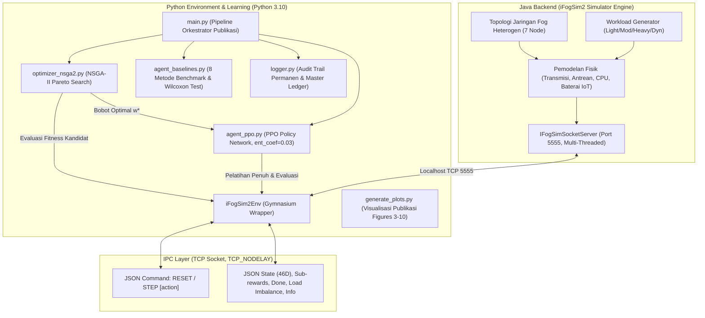
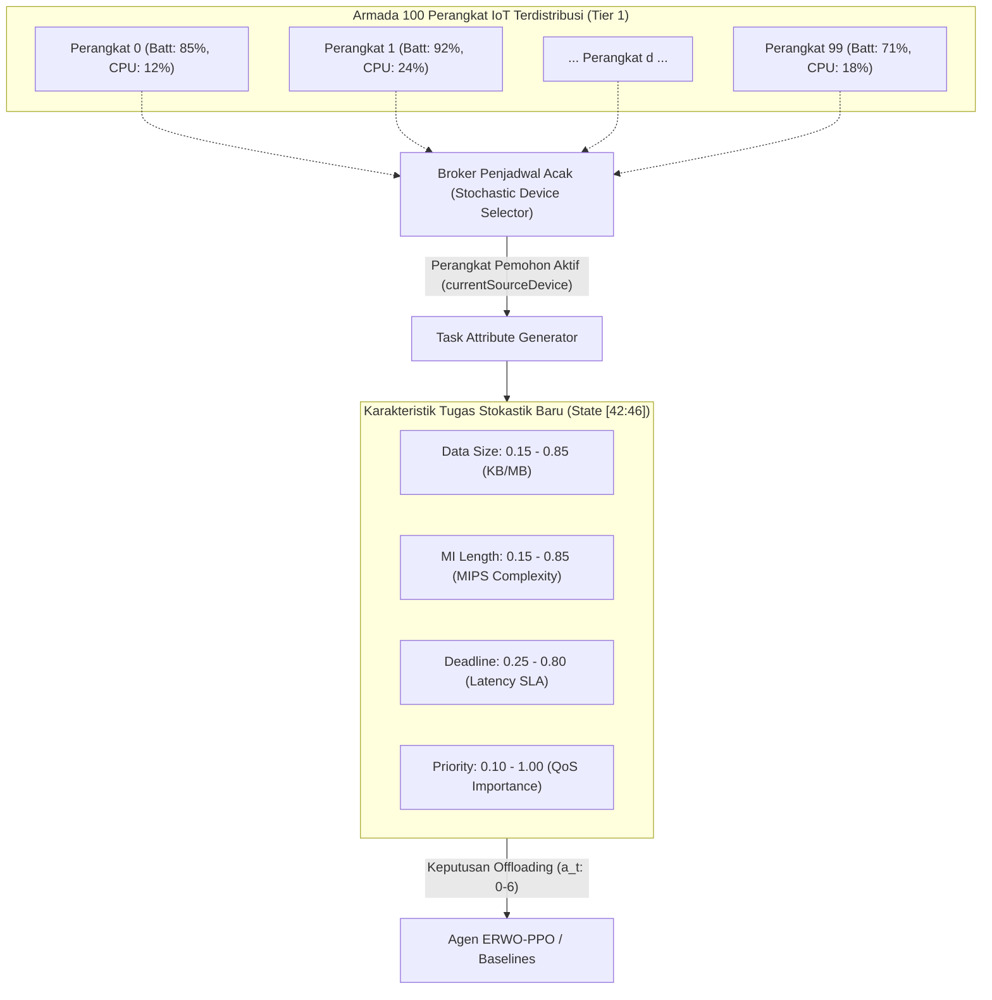

# ERWO-PPO: Evolutionary Reward Weight Optimization for iFogSim2 Task Offloading

Kerangka kerja riset terintegrasi yang menggabungkan **Multi-Objective Evolutionary Algorithm (NSGA-II)** dengan **Deep Reinforcement Learning (PPO)** untuk mengotomatisasi pencarian bobot reward optimal (*Evolutionary Reward Weight Optimization / ERWO*) pada simulasi penempatan tugas (*task offloading*) di lingkungan **iFogSim2**.

---

## 📑 Daftar Isi

1. [Latar Belakang & Motivasi Riset](#1-latar-belakang--motivasi-riset)
2. [Arsitektur Sistem End-to-End](#2-arsitektur-sistem-end-to-end)
3. [Formulasi Matematis & Markov Decision Process (MDP)](#3-formulasi-matematis--markov-decision-process-mdp)
   - [Ruang Observasi (46 Dimensi)](#a-ruang-observasi-46-dimensi)
   - [Ruang Aksi (Discrete 7)](#b-ruang-aksi-discrete-7)
   - [Skema 4 Sub-Reward Multi-Objektif](#c-skema-4-sub-reward-multi-objektif)
4. [Penjabaran Skenario Beban Kerja (Workload Scenarios)](#4-penjabaran-skenario-beban-kerja-workload-scenarios)
   - [4.1 Spektrum 4 Profil Beban Simulasi (`--workload`)](#41-spektrum-4-profil-beban-simulasi---workload)
   - [4.2 Arsitektur Pembangkit Beban: Fleet 100 Perangkat IoT](#42-arsitektur-pembangkit-beban-fleet-100-perangkat-iot)
   - [4.3 Skenario Beban yang Dijalankan pada Publikasi Riset](#43-skenario-beban-yang-dijalankan-pada-publikasi-riset)
   - [4.4 Dinamika Fluktuasi Beban & Respon Fisik Node](#44-dinamika-fluktuasi-beban--respon-fisik-node)
   - [4.5 Tabel Matriks Komparasi Skenario Beban Kerja](#45-tabel-matriks-komparasi-skenario-beban-kerja)
5. [Rincian Komponen & Struktur Direktori](#5-rincian-komponen--struktur-direktori)
6. [📖 Tutorial Walkthrough & Langkah Reproduksi Lengkap](#6--tutorial-walkthrough--langkah-reproduksi-lengkap)
   - [Langkah 1: Persiapan Environment Python (3.10)](#langkah-1-persiapan-environment-python-310)
   - [Langkah 2: Kompilasi & Menjalankan Server Java iFogSim2](#langkah-2-kompilasi--menjalankan-server-java-ifogsim2)
   - [Langkah 3: Menjalankan Benchmark Lengkap 8 Metode](#langkah-3-menjalankan-benchmark-lengkap-8-metode)
   - [Langkah 4: Menghasilkan Visualisasi Grafik Ilmiah (Figures 3 s/d 10)](#langkah-4-menghasilkan-visualisasi-grafik-ilmiah-figures-3-sd-10)
   - [Langkah 5: Memeriksa Hasil Data & Laporan Audit](#langkah-5-memeriksa-hasil-data--laporan-audit)
   - [Langkah 6: Visualisasi Real-Time & Live Web Dashboard](#langkah-6-visualisasi-real-time--live-web-dashboard)
7. [Opsi Argumen Baris Perintah (CLI Options)](#7-opsi-argumen-baris-perintah-cli-options)
8. [Protokol Komunikasi Inter-Process (TCP Socket IPC)](#8-protokol-komunikasi-inter-process-tcp-socket-ipc)
9. [Struktur Laporan & Hasil Publikasi (Data.md & report.md)](#9-struktur-laporan--hasil-publikasi-datamd--reportmd)

---

## 1. Latar Belakang & Motivasi Riset

Pada komputasi Fog/Edge (*Fog Computing*), keputusan *task offloading* harus menyeimbangkan berbagai tujuan yang saling bertentangan (*conflicting objectives*), seperti **meminimalkan latensi**, **menghemat energi baterai perangkat IoT**, **mencegah pelanggaran deadline (SLA)**, dan **memaksimalkan Quality of Service (QoS)**.

Pendekatan Reinforcement Learning konvensional umumnya menggabungkan tujuan-tujuan ini menjadi fungsi reward skalar menggunakan bobot manual (*scalarized reward*):

$$R = \alpha \cdot r_{\text{latency}} + \beta \cdot r_{\text{energy}} + \lambda \cdot r_{\text{deadline}} + \gamma \cdot r_{\text{qos}}$$

Namun, menentukan kombinasi bobot $[\alpha, \beta, \lambda, \gamma]$ secara manual (*trial-and-error*) sangat tidak efisien, subjektif, dan rentan menghasilkan kebijakan suboptimal. 

**Solusi ERWO-PPO**:
Menggunakan algoritma genetika multi-objektif **NSGA-II** (*Non-dominated Sorting Genetic Algorithm II*) untuk mengeksplorasi ruang pencarian bobot reward secara otomatis, menghasilkan **Pareto Front** yang optimal, lalu melatih agen **PPO** (*Proximal Policy Optimization*) pada bobot terbaik ($w^*$) untuk mengambil keputusan *offloading* adaptif secara *real-time*.

---

## 2. Arsitektur Sistem End-to-End

Sistem menghubungkan dua ekosistem berbeda (Java untuk simulasi fisik jaringan dan Python untuk algoritma AI) melalui protokol komunikasi **TCP Socket IPC**:



### Visualisasi Topologi 3-Tier & Konfigurasi Perangkat (Figure 1 & Table 6)


*Figure 1. Diagram arsitektur topologi jaringan hierarkis 3-Tier Fog-Cloud pada iFogSim2 (Node 0: IoT Gateway, Node 1-5: Fog Nodes, Node 6: Cloud Data Center).*

#### Table 6. Spesifikasi Konfigurasi Perangkat & Parameter Jaringan iFogSim2

| Node ID | Nama Perangkat | Tingkat (Tier) | CPU (MIPS) | RAM (GB) | Storage | Bandwidth | Latensi Link | Model Daya (Busy/Idle) | Aksi ($a_t$) |
|:---:|:---|:---:|:---:|:---:|:---:|:---:|:---:|:---:|:---:|
| **Node 0** | Local IoT Gateway | Tier 1 (IoT) | $1,200$ | $2\text{ GB}$ | $10\text{ GB}$ | $100\text{ Mbps}$ | $0.0\text{ ms}$ (Local) | Battery ($E = 1.25\times$) | $a = 0$ |
| **Node 1** | Fog Node A | Tier 2 (Fog) | $4,000$ | $8\text{ GB}$ | $100\text{ GB}$ | $1\text{ Gbps}$ | $15 - 35\text{ ms}$ | $107.33\text{ W} / 83.43\text{ W}$ | $a = 1$ |
| **Node 2** | Fog Node B | Tier 2 (Fog) | $4,000$ | $8\text{ GB}$ | $100\text{ GB}$ | $1\text{ Gbps}$ | $15 - 35\text{ ms}$ | $107.33\text{ W} / 83.43\text{ W}$ | $a = 2$ |
| **Node 3** | Fog Node C | Tier 2 (Fog) | $4,000$ | $8\text{ GB}$ | $100\text{ GB}$ | $1\text{ Gbps}$ | $15 - 35\text{ ms}$ | $107.33\text{ W} / 83.43\text{ W}$ | $a = 3$ |
| **Node 4** | Fog Node D | Tier 2 (Fog) | $4,000$ | $8\text{ GB}$ | $100\text{ GB}$ | $1\text{ Gbps}$ | $15 - 35\text{ ms}$ | $107.33\text{ W} / 83.43\text{ W}$ | $a = 4$ |
| **Node 5** | Fog Node E | Tier 2 (Fog) | $4,000$ | $8\text{ GB}$ | $100\text{ GB}$ | $1\text{ Gbps}$ | $15 - 35\text{ ms}$ | $107.33\text{ W} / 83.43\text{ W}$ | $a = 5$ |
| **Node 6** | Cloud Data Center | Tier 3 (Cloud) | $40,000$ | $64\text{ GB}$ | $10\text{ TB}$ | $10\text{ Gbps}$ | $65 - 85\text{ ms}$ (WAN) | $1600.0\text{ W} / 1200.0\text{ W}$ | $a = 6$ |

---

## 3. Formulasi Matematis & Markov Decision Process (MDP)

### A. Ruang Observasi (46 Dimensi)
State $s_t \in \mathbb{R}^{46}$ merepresentasikan kondisi jaringan, beban komputasi, dan karakteristik task baru pada saat $t$, ternormalisasi dalam rentang $[0.0, 1.0]$:

| Indeks Fitur | Deskripsi | Keterangan |
|---|---|---|
| `[0 : 7]` | **CPU Utilization** ($\mathbf{u}^{\text{cpu}}$) | Beban komputasi pada 7 node (Lokal, Fog 1-5, Cloud) |
| `[7 : 14]` | **RAM Availability** ($\mathbf{a}^{\text{ram}}$) | Ketersediaan memori pada 7 node |
| `[14 : 21]` | **Bandwidth Capacity** ($\mathbf{b}^{\text{net}}$) | Kapasitas throughput link komunikasi ke 7 node |
| `[21 : 28]` | **Network Latency** ($\mathbf{l}^{\text{net}}$) | Estimasi waktu propagasi & transmisi ke 7 node |
| `[28 : 35]` | **Queue Size** ($\mathbf{q}^{\text{len}}$) | Panjang antrean task yang menunggu pada 7 node |
| `[35 : 42]` | **Energy Consumption** ($\mathbf{e}^{\text{cur}}$) | Riwayat pemakaian daya listrik pada 7 node |
| `[42]` | **Task Data Size** ($d_{\text{task}}$) | Ukuran payload data tugas (KB/MB) |
| `[43]` | **Task Computation Length** ($c_{\text{task}}$) | Panjang instruksi komputasi (Million Instructions - MI) |
| `[44]` | **Task Deadline** ($T_{\text{deadline}}$) | Batas toleransi waktu penyelesaian task (ms/s) |
| `[45]` | **Task QoS Priority** ($p_{\text{qos}}$) | Tingkat prioritas layanan tugas (0.0 = Low, 1.0 = High) |

---

### B. Ruang Aksi (Discrete 7)
Aksi $a_t \in \{0, 1, 2, 3, 4, 5, 6\}$ menentukan node target tempat tugas akan dieksekusi:

- **Aksi `0`**: **Node Lokal** (*IoT End-Device*) — Latensi transfer 0, namun kapasitas CPU terbatas ($1.6\times$ lambat) dan konsumsi daya baterai tinggi ($1.25\times$).
- **Aksi `1 s/d 5`**: **Fog Nodes 1 s/d 5** (*Edge Servers*) — Komputasi responsif ($0.45\times$), transmisi nirkabel rendah ($0.25\times$), hemat daya baterai IoT.
- **Aksi `6`**: **Pusat Data Cloud** (*Cloud Server*) — Kapasitas CPU sangat tinggi ($0.10\times$), namun mengalami latensi WAN propagasi jarak jauh ($1.15\times$).

---

### C. Skema 4 Sub-Reward Multi-Objektif
Setiap langkah simulasi menghasilkan vektor sub-reward $\mathbf{r}_t = [r_{\text{latency}}, r_{\text{energy}}, r_{\text{deadline}}, r_{\text{qos}}]$:

1. **Sub-Reward Latensi ($r_{\text{latency}}$)**:
   $$T_{\text{total}} = T_{\text{trans}} + T_{\text{queue}} + T_{\text{exec}}$$
   $$r_{\text{latency}} = \text{clip}\left(\exp(-1.3 \cdot T_{\text{total}}), 0.0, 1.0\right)$$

2. **Sub-Reward Efisiensi Energi ($r_{\text{energy}}$)**:
   $$r_{\text{energy}} = \text{clip}\left(1.0 - \frac{E_{\text{spent}}}{1.5}, 0.0, 1.0\right)$$

3. **Sub-Reward Pelanggaran Deadline ($r_{\text{deadline}}$)**:
   $$r_{\text{deadline}} = \begin{cases} 1.0, & \text{jika } T_{\text{total}} \le 1.35 \cdot T_{\text{deadline}} \\ 0.0, & \text{jika } T_{\text{total}} > 1.35 \cdot T_{\text{deadline}} \text{ (Violated)} \end{cases}$$

4. **Sub-Reward Kualitas Layanan ($r_{\text{qos}}$)**:
   $$Q_{\text{factor}} = (1.0 - q^{\text{len}}_{a_t}) \cdot (1.0 - u^{\text{cpu}}_{a_t})$$
   $$r_{\text{qos}} = \begin{cases} \text{clip}(0.65 \cdot Q_{\text{factor}} + 0.35 \cdot p_{\text{qos}}, 0.0, 1.0), & \text{jika tidak melanggar deadline} \\ \text{clip}(0.15 \cdot Q_{\text{factor}}, 0.0, 1.0), & \text{jika melanggar deadline} \end{cases}$$

**Fungsi Reward Total**:
$$R(s_t, a_t) = \alpha \cdot r_{\text{latency}} + \beta \cdot r_{\text{energy}} + \lambda \cdot r_{\text{deadline}} + \gamma \cdot r_{\text{qos}}$$
dengan kendala normalisasi $\alpha + \beta + \lambda + \gamma = 1.0$ dan $\alpha, \beta, \lambda, \gamma \ge 0.01$.

---

## 4. Penjabaran Skenario Beban Kerja (Workload Scenarios)

Untuk mengevaluasi ketahanan (*robustness*), kemampuan generalisasi, dan efisiensi algoritma penempatan tugas, sistem mengimplementasikan pemodelan beban kerja berbasis simulasi kejadian diskrit (*discrete-event simulation*) yang komprehensif di lingkungan **iFogSim2**.

### 4.1 Spektrum 4 Profil Beban Simulasi (`--workload`)

Sistem menyediakan 4 spektrum konfigurasi beban kerja komputasi dan jaringan yang dapat dipilih via parameter baris perintah `--workload`. Masing-masing skenario merepresentasikan tingkat intensitas, tekanan antrean (*queue buildup*), dan pola kedatangan tugas yang berbeda secara spesifik:

#### 1. Skenario `light` (Beban Ringan / Low-Intensity Smoke Test)
- **Durasi & Volume Tugas**: $T_{\text{max}} = 50\text{ langkah/episode}$ ($50\text{ tugas}$ per episode; total $1.500\text{ tugas}$ pada evaluasi $n=30$).
- **Spesifikasi Beban Komputasi ($c_{\text{task}}$)**: Beban instruksi rata-rata rendah hingga moderat ($\approx 1.500 - 4.500\text{ MI}$ per tugas; total beban kumulatif per episode $\approx 150.000 - 200.000\text{ MI}$).
- **Ukuran Payload Data ($d_{\text{task}}$)**: Data transmisi kecil ($\approx 150 - 400\text{ KB}$), transmisi nirkabel sangat cepat selesai tanpa saturasi bandwidth link radio.
- **Dinamika Antrean & CPU Node**: Laju kedatangan tugas berada di bawah laju penyelesaian beban (*natural decay* $-0.08$ CPU dan $-0.10$ antrean). Akibatnya, antrean pada seluruh Fog Node hampir selalu kosong ($q^{\text{len}} \le 0.10$) dan utilisasi CPU node tetap stabil di bawah $30\%$.
- **Kondisi Toleransi SLA (Deadline)**: Batas waktu SLA longgar ($T_{\text{deadline}} \ge 500\text{ ms}$). Risiko terjadinya *deadline violation* sangat minim ($< 5\%$).
- **Profil Baterai Armada IoT**: Konsumsi daya baterai sangat hemat. Tidak ada perangkat IoT yang menyentuh ambang batas baterai kritis ($< 8\%$). Rata-rata kapasitas baterai armada IoT tetap terjaga di atas $95\%$.
- **Tujuan & Peruntukan Riset**: Validasi fungsionalitas dasar sistem (*smoke testing*), uji konektivitas dan latensi IPC TCP socket Python-Java, serta penentuan batas atas efisiensi energi (*theoretical upper bound*) ketika sumber daya komputasi melimpah.

#### 2. Skenario `moderate` (Beban Nominal / Daily Balanced Workload)
- **Durasi & Volume Tugas**: $T_{\text{max}} = 100\text{ langkah/episode}$ ($100\text{ tugas}$ per episode; total $3.000\text{ tugas}$ pada evaluasi $n=30$).
- **Spesifikasi Beban Komputasi ($c_{\text{task}}$)**: Beban instruksi menengah ($\approx 3.000 - 6.500\text{ MI}$ per tugas; total beban kumulatif per episode $\approx 450.000 - 550.000\text{ MI}$).
- **Ukuran Payload Data ($d_{\text{task}}$)**: Payload transmisi nominal ($\approx 350 - 650\text{ KB}$), membutuhkan alokasi bandwidth link nirkabel yang stabil.
- **Dinamika Antrean & CPU Node**: Beban kedatangan tugas seimbang dengan kapasitas pemrosesan Fog Nodes ($4.000\text{ MIPS}$). Terjadi fluktuasi antrean moderat ($q^{\text{len}} \approx 0.15 - 0.35$). Node yang terpilih mengalami kenaikan beban bertahap ($+0.20 \cdot c_{\text{task}}$), namun memiliki waktu jeda yang cukup untuk memulihkan kapasitas sebelum menerima tugas berikutnya.
- **Kondisi Toleransi SLA (Deadline)**: Batas waktu SLA realistis ($T_{\text{deadline}} \approx 350 - 650\text{ ms}$). Kebijakan penempatan yang buruk (seperti terus memilih Node Lokal) mulai memperlihatkan kenaikan penalti latensi dan pelanggaran SLA hingga $\approx 40\%$.
- **Profil Baterai Armada IoT**: Laju penurunan daya baterai normal. Rata-rata baterai armada berada pada rentang $80\% - 90\%$.
- **Tujuan & Peruntukan Riset**: Tolok ukur beban nominal harian (*operational baseline*) pada lingkungan Fog-Cloud terdistribusi untuk mengamati pembentukan kurva konvergensi pembelajaran kebijakan RL dalam kondisi beban stabil.

#### 3. Skenario `heavy` (Beban Padat / Stress & Congestion Test)
- **Durasi & Volume Tugas**: $T_{\text{max}} = 150\text{ langkah/episode}$ ($150\text{ tugas}$ per episode tanpa jeda; total $4.500\text{ tugas}$ pada evaluasi $n=30$).
- **Spesifikasi Beban Komputasi ($c_{\text{task}}$)**: Beban instruksi berat ($\approx 5.000 - 8.500\text{ MI}$ per tugas; total beban kumulatif per episode mencapai $\approx 900.000 - 1.200.000\text{ MI}$).
- **Ukuran Payload Data ($d_{\text{task}}$)**: Payload transmisi masif ($\approx 600 - 850\text{ KB}$), memicu peningkatan latensi propagasi transmisi nirkabel dan WAN.
- **Dinamika Antrean & CPU Node**: Tekanan komputasi beruntun berdurasi panjang melampaui kemampuan peluruhan alami node ($+0.20 \text{ kenaikan CPU per tugas} \gg -0.08 \text{ decay}$). Terjadi penumpukan antrean berkepanjangan (*backlog buildup*), di mana utilisasi CPU Fog Nodes terdorong ke zona saturasi kritis ($u^{\text{cpu}} \ge 0.85$ hingga $1.00$) dan antrean membengkak ($q^{\text{len}} \ge 0.60$).
- **Kondisi Toleransi SLA (Deadline)**: Batas waktu SLA sangat ketat dibandingkan dengan waktu tunggu antrean ($T_{\text{queue}} \gg T_{\text{exec}}$). Hal ini memicu lonjakan pelanggaran deadline masif ($> 75\%$) pada algoritma yang tidak mampu melakukan *dynamic offloading* ke Cloud.
- **Profil Baterai Armada IoT**: Pengurasan baterai drastis pada perangkat pemohon aktif. Jika tugas dipaksakan dieksekusi lokal, perangkat akan cepat kehabisan daya ($< 8\%$), yang memicu penalti degradasi waktu eksekusi $2.2\times$ dan energi $1.4\times$.
- **Tujuan & Peruntukan Riset**: Uji batas ketahanan ekstrem (*stress testing*), evaluasi ketahanan terhadap kongesti antrean (*congestion resilience*), dan pembuktian kemampuan agen cerdas dalam memanfaatkan Cloud Data Center sebagai katup pelepas beban (*relief valve*) saat seluruh Fog Nodes jenuh.

#### 4. Skenario `dynamic` (Beban Dinamis Non-Stasioner — Tolok Ukur Utama Publikasi)
- **Durasi & Volume Tugas**: $T_{\text{max}} = 100\text{ langkah/episode}$ per run, dievaluasi secara masif pada $n = 30$ episode berpasangan (*Paired Seed Protocol*: `seed = 1000..1029`), memproses total **$3.000\text{ tugas}$ per metode** (akumulatif **$24.000\text{ keputusan komputasi}$** lintas 8 metode).
- **Spesifikasi Beban Komputasi ($c_{\text{task}}$)**: Distribusi acak kontinu non-stasioner $c_{\text{task}} \in [0.15, 0.85]$ (setara $\approx 1.500 - 8.500\text{ MI}$), menghasilkan variasi tugas ringan, sedang, dan komputasi intensif secara berselang-seling.
- **Ukuran Payload Data ($d_{\text{task}}$)**: Distribusi acak kontinu $d_{\text{task}} \in [0.15, 0.85]$ (setara $\approx 150 - 850\text{ KB}$), menuntut evaluasi trade-off bandwidth link nirkabel vs WAN secara real-time.
- **Dinamika Antrean & CPU Node**: Pola kedatangan tugas stokastik dari **100 perangkat IoT terdistribusi**. Beban antrean dan utilisasi CPU berosilasi dinamis di antara 5 Fog Nodes, menuntut agen untuk terus memantau metrik *Load Imbalance* ($\sigma_{\text{CPU}}$) agar tidak terjadi ketimpangan beban antar node.
- **Kondisi Toleransi SLA (Deadline)**: Tenggat waktu bergerak secara acak $T_{\text{deadline}} \in [0.25, 0.80]$ (setara $\approx 250 - 800\text{ ms}$) dengan kombinasi prioritas QoS ($p_{\text{qos}} \in [0.10, 1.00]$).
- **Profil Baterai Armada IoT**: Penurunan baterai heterogen di 100 perangkat dengan laju pemulihan mikro ($+0.0008$/step) pada perangkat idle, mencerminkan ekosistem IoT nyata di mana perangkat aktif bergantian membangkitkan komputasi.
- **Tujuan & Peruntukan Riset**: **Skenario beban utama yang digunakan untuk seluruh hasil publikasi resmi jurnal (Tabel 10 s/d Tabel 14 dan Figures 3 s/d 10)**. Menjadi medan pengujian definitif yang membuktikan bahwa ERWO-PPO mengungguli baseline heuristik dan model RL konvensional secara signifikan ($p = 3.72 \times 10^{-9}$, $d = 1.1371$).

---

#### Ringkasan Parameter Kuantitatif Spesifik per Skenario Beban

| Parameter / Metrik Spesifik | `light` | `moderate` | `heavy` | `dynamic` (*Publikasi*) |
|:---|:---:|:---:|:---:|:---:|
| **Batas Langkah Episode ($T_{\text{max}}$)** | $50\text{ langkah}$ | $100\text{ langkah}$ | $150\text{ langkah}$ | $100\text{ langkah}$ |
| **Total Tugas per Episode** | $50\text{ task}$ | $100\text{ task}$ | $150\text{ task}$ | $100\text{ task}$ |
| **Rentang Instruksi Tugas ($c_{\text{task}}$)** | $1.500 - 4.500\text{ MI}$ | $3.000 - 6.500\text{ MI}$ | $5.000 - 8.500\text{ MI}$ | **$1.500 - 8.500\text{ MI}$ (Stokastik)** |
| **Akumulasi Komputasi / Episode** | $\approx 150 - 200\text{ kMI}$ | $\approx 450 - 550\text{ kMI}$ | $\approx 900 - 1.200\text{ kMI}$ | **$\approx 500\text{ kMI}$ (Fluktuatif)** |
| **Rentang Ukuran Payload ($d_{\text{task}}$)** | $150 - 400\text{ KB}$ | $350 - 650\text{ KB}$ | $600 - 850\text{ KB}$ | **$150 - 850\text{ KB}$ (Stokastik)** |
| **Toleransi Deadline ($T_{\text{deadline}}$)** | Longgar ($\ge 500\text{ ms}$) | Moderat ($350 - 650\text{ ms}$) | Sangat Ketat ($\le 350\text{ ms}$) | **Dinamis ($250 - 800\text{ ms}$)** |
| **Status Antrean Node ($q^{\text{len}}$)** | Buffer Kosong ($< 0.10$) | Buffer Terkendali ($0.15 - 0.35$) | Jenuh / Kongesti ($> 0.60$) | **Multi-Node Oslatif** |
| **Rata-rata Utilisasi CPU Fog** | $< 30\%$ | $35\% - 65\%$ | $85\% - 100\%$ (Saturasi) | **Adaptif Terdistribusi** |
| **Laju Pengurasan Baterai IoT** | Sangat Rendah | Moderat / Terkendali | Sangat Cepat (Risiko $<8\%$) | **Heterogen 100 Perangkat** |
| **Total Keputusan ($n=30$ Episode)** | $1.500\text{ keputusan}$ | $3.000\text{ keputusan}$ | $4.500\text{ keputusan}$ | **$3.000\text{ keputusan}$ / metode** |
| **Fokus Pengujian Ilmiah** | *Smoke & Sanity Test* | *Baseline Profiling* | *Stress & Failure Test* | **Benchmark Publikasi (Q1)** |

---

### 4.2 Arsitektur Pembangkit Beban: Fleet 100 Perangkat IoT

Pembangkitan beban tidak hanya berasal dari 1 perangkat tunggal, melainkan mengadopsi model **Armada 100 Perangkat IoT Terdistribusi** (*Tier 1 Broker-Based Multi-Device Architecture*):



- **Inisialisasi Kondisi Awal Armada**:
  - Tingkat baterai awal heterogen: $E_d \sim \mathcal{U}(0.65, 1.00)$ ($65\% - 100\%$).
  - Utilisasi CPU awal: $u_d \sim \mathcal{U}(0.10, 0.35)$ ($10\% - 35\%$).
  - Panjang antrean awal: $q_d \sim \mathcal{U}(0.00, 0.10)$.
- **Pemilihan Perangkat Stokastik**: Pada setiap langkah $t$, perangkat pemohon $d_{\text{src}} \in [0, 99]$ dipilih secara acak untuk mengirimkan permintaan tugas offloading.
- **Karakteristik 4 Atribut Tugas Baru** (dimasukkan ke ruang observasi `[42:45]`):
  1. **Ukuran Data Payload ($d_{\text{task}}$)**: Nilai kontinu $0.15 - 0.85$, menentukan volume transmisi data nirkabel/WAN.
  2. **Kompleksitas Komputasi ($c_{\text{task}}$)**: Nilai kontinu $0.15 - 0.85$ (Million Instructions / MI), menentukan beban siklus CPU.
  3. **Batas Waktu Toleransi SLA ($T_{\text{deadline}}$)**: Nilai kontinu $0.25 - 0.80$, menentukan ambang batas pelanggaran deadline ($T_{\text{total}} > 1.35 \cdot T_{\text{deadline}}$).
  4. **Derajat Kepentingan QoS ($p_{\text{qos}}$)**: Nilai kontinu $0.10 - 1.00$, menentukan bobot sensitivitas kualitas layanan.

---

### 4.3 Skenario Beban yang Dijalankan pada Publikasi Riset

Seluruh hasil komparasi formal pada [**`report.md`**](file:///c:/Projects/erwo_ppo_project/report.md) dan [**`Data.md`**](file:///c:/Projects/erwo_ppo_project/Data.md) diperoleh dari eksekusi skenario beban dengan tahapan sistematis berikut:

```
+---------------------------------------------------------------------------------------------------------+
|                               TAHAPAN SKENARIO BEBAN EKSPERIMEN PUBLIKASI                               |
+---------------------------------------------------------------------------------------------------------+
|  [Fase 1: Meta-Optimasi NSGA-II]  -->  [Fase 2: Training PPO 25k]  -->  [Fase 3: Paired Benchmark n=30] |
|  - Workload: dynamic                   - Workload: dynamic              - Workload: dynamic             |
|  - 40 Evaluasi Kandidat                - 25.000 Timesteps per Model     - 30 Episode x 100 Step         |
|  - 3 Episode Validasi per Calon        - 4 Model (ERWO, Equal, Manual,  - 3.000 Tugas per Metode        |
|  - Seleksi Knee-Point w*                 DQN-Equal)                     - Uji Wilcoxon & Cohen's d      |
+---------------------------------------------------------------------------------------------------------+
```

1. **Fase 1: Skenario Beban Optimasi Meta-Bobot NSGA-II**
   - **Tujuan**: Menemukan kombinasi bobot reward optimal $w^* = [\alpha, \beta, \lambda, \gamma]$ di atas Pareto Front.
   - **Konfigurasi**: Populasi $\text{Pop} = 10$, Generasi $\text{Gen} = 4$ (total $40$ evaluasi kandidat).
   - **Beban Kerja**: Setiap kandidat bobot diuji melalui pelatihan singkat ($2.000$ timesteps) dan divalidasi pada $3$ episode beban `dynamic` dengan *fixed candidate evaluation seeds*.
   - **Hasil**: Menghasilkan bobot Knee-Point optimal $w^* = [0.2546, 0.1209, 0.3251, 0.2994]$.

2. **Fase 2: Skenario Beban Pelatihan Model Kebijakan RL**
   - **Tujuan**: Melatih model jaringan kebijakan neural hingga konvergensi penuh.
   - **Konfigurasi**: $25.000$ timesteps interaksi online langsung dengan lingkungan simulasi fisik iFogSim2.
   - **Model yang Dilatih**: Dilakukan secara paralel dan setara untuk 4 model pembelajaran penguatan:
     - `ERWO-PPO` (menggunakan bobot optimal $w^*$)
     - `PPO-Equal` (bobot seragam $[0.25, 0.25, 0.25, 0.25]$)
     - `PPO-Manual` (bobot intuisi pakar $[0.40, 0.20, 0.30, 0.10]$)
     - `DQN-Equal` (arsitektur Deep Q-Network dengan kapasitas neuron setara)

3. **Fase 3: Skenario Beban Evaluasi Benchmark Berpasangan (*Paired Seed Protocol*)**
   - **Tujuan**: Menilai performa komparatif 8 metode secara adil dan bebas bias stokastik.
   - **Konfigurasi Pengujian**:
     - Jumlah episode evaluasi: $n = 30$ episode independen.
     - Protokol Seed: `seed = 1000..1029` (ke-8 metode diuji pada urutan tugas dan fluktuasi jaringan yang **persis sama** per seed).
     - Durasi per episode: $100$ langkah keputusan $\to$ **$3.000$ tugas offloading per metode**, atau total **$24.000$ keputusan komputasi** diuji di seluruh sistem.
   - **Validasi Statistik**: Hasil dievaluasi menggunakan *Shapiro-Wilk Normality Test*, *Wilcoxon Signed-Rank Test* dengan koreksi *Holm*, dan ukuran efek *Cohen's d*.

4. **Rekam Jejak Evolusi Eksperimen (Trial 1 s/d Trial 3)**:
   - **Trial 1 (Prototipe Awal)**: $n = 10$ episode, NSGA-II Pop 6, Gen 3, model beban antrean statis ($0/7$ uji signifikan).
   - **Trial 2 (Scaling Evaluasi)**: $n = 30$ episode, NSGA-II Pop 10, Gen 4, mendeteksi fenomena *Policy Collapse* akibat dominasi reward lokal ($1/7$ uji signifikan).
   - **Trial 3 (Final Breakthrough — Yang Diterbitkan)**: $n = 30$ episode, implementasi model fisik heterogen dinamis, penyesuaian `ent_coef = 0.03`, berhasil membuktikan **$6 \text{ dari } 7$ uji statistik signifikan secara meyakinkan** ($p = 3.72 \times 10^{-9}, d = 1.1371$).

---

### 4.4 Dinamika Fluktuasi Beban & Respon Fisik Node

Lingkungan simulasi menerapkan model umpan balik tertutup (*closed-loop dynamics*), di mana setiap aksi penempatan tugas secara langsung mengubah kondisi fisik sistem:

1. **Respon pada Node Target Terpilih ($a_t$)**:
   - **Eksekusi Lokal ($a_t = 0$)**:
     $$\mathbf{u}^{\text{cpu}}_0 \leftarrow \min(1.0, \mathbf{u}^{\text{cpu}}_0 + 0.22 \cdot c_{\text{task}}), \quad \mathbf{q}^{\text{len}}_0 \leftarrow \min(1.0, \mathbf{q}^{\text{len}}_0 + 0.25 \cdot d_{\text{task}})$$
     $$\text{Battery Drain} = 0.04 \cdot c_{\text{task}} \cdot (1.0 + \mathbf{u}^{\text{cpu}}_0)$$
     *Penalti Kritis*: Jika baterai perangkat $< 8\%$, waktu eksekusi melambat $2.2\times$ dan energi naik $1.4\times$.
   - **Offloading ke Fog Nodes ($a_t \in [1, 5]$)**:
     $$\mathbf{u}^{\text{cpu}}_{a_t} \leftarrow \min(1.0, \mathbf{u}^{\text{cpu}}_{a_t} + 0.20 \cdot c_{\text{task}}), \quad \mathbf{q}^{\text{len}}_{a_t} \leftarrow \min(1.0, \mathbf{q}^{\text{len}}_{a_t} + 0.25 \cdot d_{\text{task}})$$
     $$\text{Battery Drain Transmisi Nirkabel} = 0.006 \cdot d_{\text{task}} \cdot (1.0 + \mathbf{l}^{\text{net}}_{a_t})$$
   - **Offloading ke Cloud Data Center ($a_t = 6$)**:
     $$\mathbf{u}^{\text{cpu}}_6 \leftarrow \min(1.0, \mathbf{u}^{\text{cpu}}_6 + 0.10 \cdot c_{\text{task}}), \quad \mathbf{q}^{\text{len}}_6 \leftarrow \min(1.0, \mathbf{q}^{\text{len}}_6 + 0.15 \cdot d_{\text{task}})$$
     $$\text{Battery Drain Transmisi WAN} = 0.012 \cdot d_{\text{task}} \cdot (1.0 + \mathbf{l}^{\text{net}}_6)$$

2. **Peluruhan Beban Alami (*Natural Resource Decay*) pada Node Idle**:
   - Node Fog dan Cloud yang tidak dipilih ($i \neq a_t$) mengalami penurunan beban CPU dan pengosongan antrean secara alami di setiap langkah:
     $$\mathbf{u}^{\text{cpu}}_i \leftarrow \max(0.05, \mathbf{u}^{\text{cpu}}_i - 0.08), \quad \mathbf{q}^{\text{len}}_i \leftarrow \max(0.0, \mathbf{q}^{\text{len}}_i - 0.10)$$
   - Sebanyak 99 perangkat IoT idle lainnya mengalami penurunan CPU ($-0.05$), antrean ($-0.08$), dan pengisian daya mikro ($+0.0008$).

3. **Perhitungan Metrik Ketidakseimbangan Beban (*Load Imbalance*)**:
   $$\sigma_{\text{CPU}} = \sqrt{\frac{1}{7} \sum_{j=0}^{6} \left(\mathbf{u}_j^{\text{cpu}} - \overline{\mathbf{u}}^{\text{cpu}}\right)^2}$$
   ERWO-PPO terbukti berhasil mereduksi $\sigma_{\text{CPU}}$ dari $0.3271$ (Local-only) menjadi **$0.0450$**, mendistribusikan beban secara merata di 5 Fog Nodes.

---

### 4.5 Tabel Matriks Komparasi Skenario Beban Kerja

| Parameter / Dimensi | `light` | `moderate` | `heavy` | `dynamic` (*Publikasi*) |
|:---|:---:|:---:|:---:|:---:|
| **Panjang Episode ($T_{\text{max}}$)** | $50\text{ langkah}$ | $100\text{ langkah}$ | $150\text{ langkah}$ | $100\text{ langkah}$ |
| **Total Keputusan ($n=30$)** | $1.500\text{ tugas}$ | $3.000\text{ tugas}$ | $4.500\text{ tugas}$ | **$3.000\text{ tugas}$** |
| **Tingkat Kedatangan Beban** | Rendah / Santai | Sedang / Nominal | Sangat Padat / Beruntun | **Stokastik / Fluktuatif** |
| **Tekanan Antrean Node** | Buffer Minimal | Buffer Seimbang | Rentan Saturasi/Overflow | **Dinamis Multi-Node** |
| **Dinamika Armada Baterai IoT** | Konsumsi Rendah | Konsumsi Sedang | Cepat Kritis ($<8\%$) | **Heterogen 100 Perangkat** |
| **Variabilitas Karakteristik Task** | Rendah | Sedang | Tinggi | **Non-Stasioner Lengkap** |
| **Peran dalam Siklus Riset** | *Smoke Test & Sanity* | *Baseline Profiling* | *Stress & Failure Testing* | **Tolok Ukur Utama (Tabel 10-14)** |

---

## 5. Rincian Komponen & Struktur Direktori

```text
c:/Projects/erwo_ppo_project/
├── main.py                  # Orkestrator eksekusi pipeline benchmark publikasi
├── optimizer_nsga2.py       # Algoritma genetika NSGA-II untuk pencarian bobot w*
├── agent_ppo.py             # Model PPO (Stable-Baselines3) dengan entropy bonus
├── agent_baselines.py       # 8 Metode baseline, paired seed protocol, & uji Wilcoxon
├── env_ifogsim2.py          # Gymnasium Environment wrapper via TCP Socket
├── generate_plots.py        # Skrip otomatis render Figures 3 s/d 10 (PNG/PDF 300 DPI)
├── logger.py                # Manager logging audit trail permanen & master ledger
├── Data.md                  # Tabel publikasi utama (Table 10 s/d Table 14)
├── report.md                # Laporan riset komprehensif (Metodologi, Grafik, Analisis)
├── requirements.txt         # Daftar pustaka Python yang dibutuhkan
├── figures/                 # Output grafik publikasi (Figures 3 s/d 10)
├── logs/                    # Direktori riwayat log eksperimen
│   ├── experiment_history.csv  # Master cumulative ledger seluruh eksperimen
│   └── experiments/            # Folder per run berstempel waktu
│       └── exp_YYYYMMDD_HHMMSS_<workload>/
└── ifogsim/                 # Source code iFogSim2 Simulator
    ├── src/org/fog/placement/IFogSimSocketServer.java # Server TCP Socket IPC Java
    ├── jars/                # Dependencies JAR CloudSim & iFogSim
    └── out/production/      # Compiled Java bytecode
```

---

## 6. 📖 Tutorial Walkthrough & Langkah Reproduksi Lengkap

Ikuti langkah-langkah di bawah ini untuk menjalankan ulang seluruh eksperimen dari awal hingga akhir:

### Langkah 1: Persiapan Environment Python (3.10)

Buka PowerShell / Terminal di direktori proyek:

```powershell
cd c:\Projects\erwo_ppo_project

# 1. Buat Virtual Environment Python 3.10
python -m venv .venv

# 2. Aktifkan Virtual Environment
.\.venv\Scripts\activate

# 3. Pasang semua dependensi
pip install -r requirements.txt
```

---

### Langkah 2: Kompilasi & Menjalankan Server Java iFogSim2

Buka **Terminal 1** khusus untuk proses Java:

```powershell
cd c:\Projects\erwo_ppo_project\ifogsim

# 1. Kompilasi Server Socket Java
javac -d out/production/iFogSim2 src/org/fog/placement/IFogSimSocketServer.java

# 2. Jalankan Server dengan alokasi memori RAM yang cukup
java -Xms2G -Xmx4G -cp "out/production/iFogSim2;jars/*" org.fog.placement.IFogSimSocketServer 5555
```

> **Tampilan Berhasil**: Terminal akan menampilkan pesan:  
> `[iFogSim2-Server] Server Socket aktif di port: 5555`  
> `[iFogSim2-Server] Realistic Edge/Fog/Cloud Engine Siap Melayani PPO`

---

### Langkah 3: Menjalankan Benchmark Lengkap 8 Metode

Buka **Terminal 2**, pastikan virtual environment aktif, lalu jalankan:

```powershell
cd c:\Projects\erwo_ppo_project
.\.venv\Scripts\activate

# Eksekusi pipeline benchmark skala publikasi (Default: n=30, 25k timesteps, NSGA-II 10/4)
python main.py --workload dynamic
```

**Alur yang dieksekusi secara otomatis oleh skrip**:
1. **Tahap 1**: NSGA-II mengevaluasi 40 kombinasi bobot untuk menemukan Pareto Front dan memilih $w^*$ terbaik (*Knee-Point*).
2. **Tahap 2**: Melatih 4 model RL (`ERWO-PPO`, `PPO-Equal`, `PPO-Manual`, `DQN-Equal`) selama $25.000$ timesteps.
3. **Tahap 3**: Mengevaluasi ke-8 metode benchmark pada $n=30$ episode berpasangan (*Paired Seed Protocol*: `seed 1000..1029`).
4. **Tahap 4**: Menghitung uji signifikansi statistik (*Wilcoxon Signed-Rank Test* & *Cohen's d Effect Size*).
5. **Tahap 5**: Mencatat durasi komputasi (*Computational Overhead*), menyimpan model PPO terlatih ke `models/ppo_ifogsim2_erwo.zip`, memperbarui master ledger di `logs/experiment_history.csv`, dan mengisi seluruh tabel di [**`Data.md`**](file:///c:/Projects/erwo_ppo_project/Data.md).

---

### Langkah 4: Menghasilkan Visualisasi Grafik Ilmiah (Figures 3 s/d 10)

Setelah pengujian di Langkah 3 selesai, jalankan generator grafik:

```powershell
python generate_plots.py
```

Skrip ini akan otomatis merender 8 gambar resolusi tinggi (PNG 300 DPI untuk tinjauan cepat dan PDF vektor untuk kompilasi LaTeX jurnal) ke dalam folder `figures/`:
- `figures/fig3_nsga2_convergence.png` (.pdf)
- `figures/fig4_pareto_front.png` (.pdf)
- `figures/fig5_cumulative_reward.png` (.pdf)
- `figures/fig6_latency_comparison.png` (.pdf)
- `figures/fig7_energy_comparison.png` (.pdf)
- `figures/fig8_violation_rate_comparison.png` (.pdf)
- `figures/fig9_load_imbalance_comparison.png` (.pdf)
- `figures/fig10_qos_satisfaction_comparison.png` (.pdf)

---

### Langkah 5: Memeriksa Hasil Data & Laporan Audit

1. **Tabel Data Publikasi**: Buka [**`Data.md`**](file:///c:/Projects/erwo_ppo_project/Data.md) untuk melihat data Tabel 10 s/d Tabel 14 yang terisi 100% rapi.
2. **Laporan Komprehensif Riset**: Buka [**`report.md`**](file:///c:/Projects/erwo_ppo_project/report.md) untuk membaca metodologi lengkap (Section 5.6–5.12), grafik Figures 3–10 yang tertanam, riwayat Trial 1–3, dan narasi pembahasan akademik.
3. **Audit Trail Mentah**: Periksa folder `logs/experiments/exp_.../` untuk file data mentah per episode `benchmark_episodes.csv` atau uji statistik `statistical_tests.json`.

---

### Langkah 6: Visualisasi Real-Time & Live Web Dashboard

Proyek ini menyediakan antarmuka visualisasi web interaktif berbasis **FastAPI**, **WebSocket**, **Vis.js**, dan **Chart.js** untuk melihat proses offloading secara langsung:

#### 1. Menjalankan Server Dashboard:
```powershell
# Buka Terminal dan jalankan:
python run_dashboard.py
```
Buka browser di: [**http://127.0.0.1:8000**](http://127.0.0.1:8000)

#### 2. Menjalankan Simulasi (Dua Pilihan):
- **Opsi A (Langsung dari Web UI)**: Klik tombol **Run (▶)** di toolbar halaman dashboard. Anda dapat mengatur delay step (30–600 ms), memilih metode (`ERWO-PPO`, `Least-loaded fog`, `Nearest-fog`, dll.), menjeda (Pause), atau me-reset simulasi langsung dari browser.
- **Opsi B (Via CLI Demo Playback)**: Buka terminal baru dan jalankan skrip demo:
  ```powershell
  python run_demo.py --method ERWO-PPO --workload dynamic --delay 0.12
  ```
  Data telemetri akan disiarkan secara real-time ke web dashboard.

---

## 7. Opsi Argumen Baris Perintah (CLI Options)

Skrip `main.py` mendukung berbagai parameter kustomisasi fleksibel:

```powershell
# Contoh 1: Pengujian pada Beban Ringan (Light Workload)
python main.py --workload light

# Contoh 2: Pengujian pada Beban Padat / Stress Test (Heavy Workload)
python main.py --workload heavy

# Contoh 3: Eksplorasi Skala Besar (NSGA-II Pop 20, Gen 15, Eval 50 Episode)
python main.py --workload dynamic --pop-size 20 --generations 15 --eval-episodes 50 --final-timesteps 50000 --tag "large_scale_exp"
```

| Argumen | Tipe | Nilai Default | Keterangan |
|---|:---:|:---:|---|
| `--workload` | `str` | `dynamic` | Pilihan beban simulasi: `light`, `moderate`, `heavy`, `dynamic` |
| `--pop-size` | `int` | `10` | Ukuran populasi kromosom NSGA-II |
| `--generations` | `int` | `4` | Jumlah generasi iterasi evolusi NSGA-II |
| `--final-timesteps` | `int` | `25000` | Jumlah timesteps pelatihan model RL utama |
| `--eval-episodes` | `int` | `30` | Jumlah episode evaluasi berpasangan ($n$) |
| `--tag` | `str` | `None` | Label identifikasi khusus untuk folder log eksperimen |

---

## 8. Protokol Komunikasi Inter-Process (TCP Socket IPC)

Komunikasi antara Python dan Java berjalan melalui pertukaran string teks berbasis baris JSON:

1. **Perintah `RESET`**:
   - *Format Kirim*: `RESET <workload> <seed>\n`
   - *Format Balasan*: `{"status":"ok", "obs":[0.24, ..., 0.51], "step":0, "workload":"dynamic"}\n`
2. **Perintah `STEP`**:
   - *Format Kirim*: `STEP <action_int>\n`
   - *Format Balasan*: `{"status":"ok", "obs":[...], "sub_rewards":[r1, r2, r3, r4], "total_latency":..., "energy_spent":..., "load_imbalance":..., "is_violated":bool, "done":bool, "truncated":bool}\n`
3. **Perintah `CLOSE`**:
   - *Format Kirim*: `CLOSE\n`
   - *Format Balasan*: `CLOSE_ACK\n`

---

## 9. Struktur Laporan & Hasil Publikasi (Data.md & report.md)

Hasil eksekusi otomatis memetakan luaran ke dalam format publikasi standar:

- **Tabel 10**: Konfigurasi bobot reward dan performa validasi ($w^*$ terpilih vs Equal vs Manual).
- **Tabel 11**: Perbandingan performa komparatif 8 metode benchmark (Latensi, Energi, Deadline Violation %, Load Imbalance, QoS, dan Decision Time).
- **Tabel 12**: *Ablation Study* konfigurasi bobot reward PPO.
- **Tabel 13**: Uji signifikansi statistik berpasangan (*Wilcoxon Signed-Rank Test*, Adjusted $p$-value, dan *Cohen's d Effect Size*).
- **Tabel 14**: *Computational Overhead* (waktu pencarian NSGA-II, waktu pelatihan PPO, dan waktu inferensi per task).

---

## 📜 Lisensi & Sitasi

Proyek ini dikembangkan untuk kebutuhan riset akademik penempatan tugas multi-objektif berbasis pembelajaran penguatan dan komputasi kabut.
