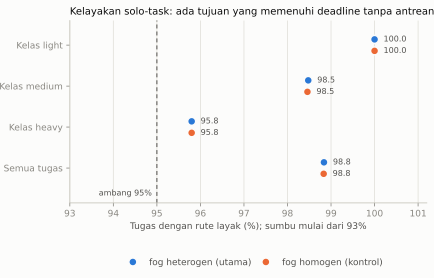
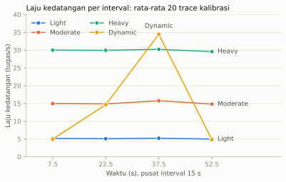
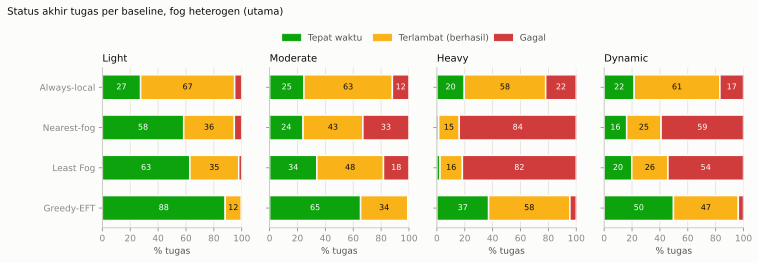
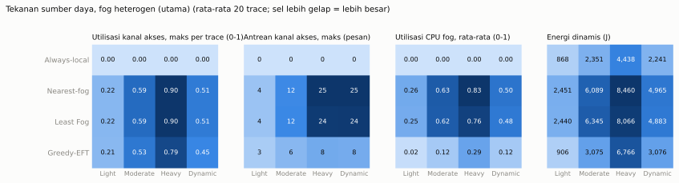
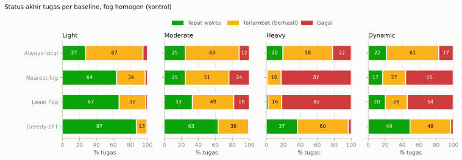
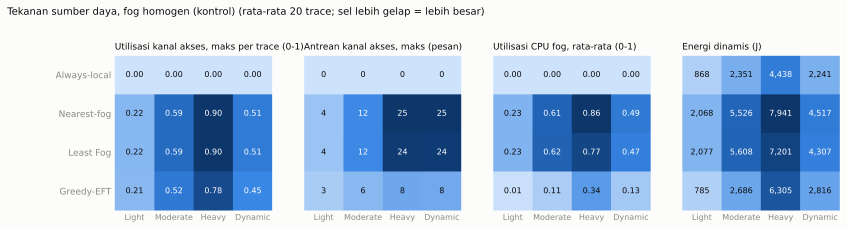

# Laporan kalibrasi P06

Dibangkitkan oleh `python -m research_v2.calibration_report` dari `rows-*.jsonl`. Hanya empat baseline deterministik pada split `calibration` (20 trace per workload); ERWO/PPO tidak digunakan untuk memilih skenario. Setiap sel adalah rata-rata 20 trace.

## Gerbang (§24.2)

| Gerbang | Hasil | Rincian |
|---|---:|---:|
| Kelengkapan (640 episode) | LULUS | 640 dari 640 |
| Distribusi trace (80 trace, pemeriksaan P01) | LULUS | 80 trace |
| Kelayakan solo-task ≥ 95% | LULUS | heterogeneous: 98.8%; homogeneous: 98.8% |
| Tekanan heavy: gagal > 1% dan reliability > 50% | LULUS | heterogeneous/always_local, heterogeneous/greedy_eft, homogeneous/always_local, homogeneous/greedy_eft |

**Keputusan: semua gerbang lulus**

## Kelayakan solo-task

Satu tugas sendirian pada sistem kosong; tugas layak bila ada tujuan (dari tujuh) yang menerima hasil sebelum deadline lunak D. Dihitung analitis dan diverifikasi terhadap engine pada tes.

| Konfigurasi | Tugas | Semua % | Kelas light % | Kelas medium % | Kelas heavy % | Workload Light % | Workload Moderate % | Workload Heavy % | Workload Dynamic % |
|---|---:|---:|---:|---:|---:|---:|---:|---:|---:|
| fog heterogen (utama) | 77936 | 98.8 | 100.0 | 98.5 | 95.8 | 99.1 | 98.8 | 98.8 | 98.9 |
| fog homogen (kontrol) | 77936 | 98.8 | 100.0 | 98.5 | 95.8 | 99.1 | 98.8 | 98.8 | 98.9 |

## Laju kedatangan

## Hasil baseline, fog heterogen (utama)

| Workload | Baseline | N | Tepat waktu % | Terlambat % | Gagal % | Reliability | D | zL zE zD zB zQ |
|---|---:|---:|---:|---:|---:|---:|---:|---:|
| Light | Always-local | 308 | 27.5 | 67.5 | 5.1 | 0.949 | 0.338 | 0.200 0.056 0.725 0.000 0.051 |
| Light | Nearest-fog | 308 | 58.4 | 36.3 | 5.3 | 0.947 | 0.329 | 0.154 0.159 0.416 0.562 0.053 |
| Light | Least Fog | 308 | 62.8 | 35.0 | 2.2 | 0.978 | 0.284 | 0.119 0.159 0.372 0.473 0.022 |
| Light | Greedy-EFT | 308 | 88.1 | 11.6 | 0.2 | 0.998 | 0.078 | 0.066 0.059 0.119 0.090 0.002 |
| Moderate | Always-local | 907 | 24.6 | 63.5 | 11.9 | 0.881 | 0.361 | 0.257 0.052 0.754 0.000 0.119 |
| Moderate | Nearest-fog | 907 | 24.0 | 42.9 | 33.1 | 0.669 | 0.510 | 0.436 0.134 0.760 0.634 0.331 |
| Moderate | Least Fog | 907 | 33.9 | 47.8 | 18.3 | 0.817 | 0.411 | 0.294 0.140 0.661 0.516 0.183 |
| Moderate | Greedy-EFT | 907 | 65.3 | 33.8 | 0.9 | 0.991 | 0.252 | 0.094 0.068 0.347 0.427 0.009 |
| Heavy | Always-local | 1798 | 19.7 | 58.4 | 21.9 | 0.781 | 0.405 | 0.351 0.049 0.803 0.000 0.219 |
| Heavy | Nearest-fog | 1798 | 1.3 | 14.7 | 84.0 | 0.160 | 0.723 | 0.901 0.094 0.987 0.336 0.840 |
| Heavy | Least Fog | 1798 | 2.2 | 16.1 | 81.7 | 0.183 | 0.727 | 0.877 0.090 0.978 0.491 0.817 |
| Heavy | Greedy-EFT | 1798 | 37.1 | 58.3 | 4.6 | 0.954 | 0.450 | 0.167 0.075 0.629 0.762 0.046 |
| Dynamic | Always-local | 884 | 21.6 | 61.5 | 16.9 | 0.831 | 0.385 | 0.306 0.051 0.784 0.000 0.169 |
| Dynamic | Nearest-fog | 884 | 16.2 | 24.7 | 59.1 | 0.409 | 0.596 | 0.668 0.112 0.838 0.511 0.591 |
| Dynamic | Least Fog | 884 | 19.8 | 26.0 | 54.2 | 0.458 | 0.562 | 0.619 0.111 0.802 0.492 0.542 |
| Dynamic | Greedy-EFT | 884 | 49.7 | 46.5 | 3.7 | 0.963 | 0.285 | 0.142 0.070 0.503 0.354 0.037 |

### Tekanan sumber daya

| Workload | Baseline | Util. akses maks | Antrean akses maks | Util. CPU fog | Antrean IoT maks | Tolak antrean CPU | Tolak antrean jaringan | Timeout % | E dinamis (J) |
|---|---:|---:|---:|---:|---:|---:|---:|---:|---:|
| Light | Always-local | 0.00 | 0.0 | 0.00 | 1.6 | 0.1 | 0.0 | 5.1 | 868 |
| Light | Nearest-fog | 0.22 | 4.5 | 0.26 | 0.0 | 0.0 | 0.0 | 5.3 | 2,451 |
| Light | Least Fog | 0.22 | 4.5 | 0.25 | 0.0 | 0.0 | 0.0 | 2.2 | 2,440 |
| Light | Greedy-EFT | 0.21 | 3.1 | 0.02 | 0.2 | 0.0 | 0.0 | 0.2 | 906 |
| Moderate | Always-local | 0.00 | 0.0 | 0.00 | 2.0 | 3.4 | 0.0 | 11.5 | 2,351 |
| Moderate | Nearest-fog | 0.59 | 12.2 | 0.63 | 0.0 | 0.0 | 0.0 | 33.1 | 6,089 |
| Moderate | Least Fog | 0.59 | 12.4 | 0.62 | 0.0 | 0.0 | 0.0 | 18.3 | 6,345 |
| Moderate | Greedy-EFT | 0.53 | 6.0 | 0.12 | 1.2 | 0.0 | 0.0 | 0.9 | 3,075 |
| Heavy | Always-local | 0.00 | 0.0 | 0.00 | 2.0 | 36.6 | 0.0 | 19.9 | 4,438 |
| Heavy | Nearest-fog | 0.90 | 25.1 | 0.83 | 0.0 | 0.0 | 0.0 | 84.0 | 8,460 |
| Heavy | Least Fog | 0.90 | 24.1 | 0.76 | 0.0 | 0.5 | 0.0 | 81.7 | 8,066 |
| Heavy | Greedy-EFT | 0.79 | 7.9 | 0.29 | 2.0 | 0.1 | 0.0 | 4.6 | 6,766 |
| Dynamic | Always-local | 0.00 | 0.0 | 0.00 | 2.0 | 11.2 | 0.0 | 15.7 | 2,241 |
| Dynamic | Nearest-fog | 0.51 | 24.9 | 0.50 | 0.0 | 0.0 | 0.0 | 59.1 | 4,965 |
| Dynamic | Least Fog | 0.51 | 24.2 | 0.48 | 0.0 | 0.0 | 0.0 | 54.2 | 4,883 |
| Dynamic | Greedy-EFT | 0.45 | 7.7 | 0.12 | 1.9 | 0.3 | 0.0 | 3.7 | 3,076 |

### Pembagian aksi (% keputusan)

| Workload | Baseline | IoT asal | F1 | F2 | F3 | F4 | F5 | Cloud |
|---|---:|---:|---:|---:|---:|---:|---:|---:|
| Light | Always-local | 100.0 | 0.0 | 0.0 | 0.0 | 0.0 | 0.0 | 0.0 |
| Light | Nearest-fog | 0.0 | 20.0 | 19.7 | 20.5 | 19.9 | 20.0 | 0.0 |
| Light | Least Fog | 0.0 | 16.5 | 19.9 | 21.7 | 21.5 | 20.4 | 0.0 |
| Light | Greedy-EFT | 7.8 | 0.0 | 0.0 | 0.0 | 0.3 | 34.8 | 57.2 |
| Moderate | Always-local | 100.0 | 0.0 | 0.0 | 0.0 | 0.0 | 0.0 | 0.0 |
| Moderate | Nearest-fog | 0.0 | 19.4 | 20.5 | 20.0 | 20.1 | 19.9 | 0.0 |
| Moderate | Least Fog | 0.0 | 11.3 | 15.3 | 20.1 | 25.1 | 28.2 | 0.0 |
| Moderate | Greedy-EFT | 23.8 | 0.0 | 0.0 | 0.2 | 7.3 | 32.7 | 36.0 |
| Heavy | Always-local | 100.0 | 0.0 | 0.0 | 0.0 | 0.0 | 0.0 | 0.0 |
| Heavy | Nearest-fog | 0.0 | 20.4 | 19.7 | 20.0 | 19.6 | 20.3 | 0.0 |
| Heavy | Least Fog | 0.0 | 13.6 | 16.6 | 19.5 | 23.2 | 27.0 | 0.0 |
| Heavy | Greedy-EFT | 51.3 | 0.0 | 0.3 | 3.5 | 12.7 | 12.9 | 19.4 |
| Dynamic | Always-local | 100.0 | 0.0 | 0.0 | 0.0 | 0.0 | 0.0 | 0.0 |
| Dynamic | Nearest-fog | 0.0 | 19.8 | 20.3 | 20.7 | 19.4 | 19.8 | 0.0 |
| Dynamic | Least Fog | 0.0 | 13.9 | 17.1 | 20.7 | 23.2 | 25.2 | 0.0 |
| Dynamic | Greedy-EFT | 39.7 | 0.0 | 0.2 | 1.9 | 8.4 | 20.9 | 28.9 |

### Estimator EFT sebagai estimator (bukan outcome)

Skor EFT tujuan terpilih dibandingkan dengan latensi nyata tugas yang berhasil (nyata − estimasi). Ini diagnostik, bukan gerbang.

| Workload | Rata-rata galat (s) | Median |galat| (s) | p95 |galat| (s) | % nyata ≥ estimasi |
|---|---:|---:|---:|---:|
| Light | +0.024 | 0.000 | 0.351 | 83.4 |
| Moderate | +0.079 | 0.024 | 0.664 | 81.1 |
| Heavy | +0.151 | 0.000 | 1.026 | 88.9 |
| Dynamic | +0.116 | 0.000 | 0.886 | 86.8 |

## Hasil baseline, fog homogen (kontrol)

| Workload | Baseline | N | Tepat waktu % | Terlambat % | Gagal % | Reliability | D | zL zE zD zB zQ |
|---|---:|---:|---:|---:|---:|---:|---:|---:|
| Light | Always-local | 308 | 27.5 | 67.5 | 5.1 | 0.949 | 0.338 | 0.200 0.056 0.725 0.000 0.051 |
| Light | Nearest-fog | 308 | 63.9 | 33.5 | 2.5 | 0.975 | 0.291 | 0.119 0.134 0.361 0.510 0.025 |
| Light | Least Fog | 308 | 66.8 | 31.5 | 1.7 | 0.983 | 0.263 | 0.109 0.135 0.332 0.453 0.017 |
| Light | Greedy-EFT | 308 | 87.1 | 12.7 | 0.3 | 0.997 | 0.072 | 0.068 0.051 0.129 0.045 0.003 |
| Moderate | Always-local | 907 | 24.6 | 63.5 | 11.9 | 0.881 | 0.361 | 0.257 0.052 0.754 0.000 0.119 |
| Moderate | Nearest-fog | 907 | 24.8 | 51.4 | 23.9 | 0.761 | 0.475 | 0.352 0.122 0.752 0.602 0.239 |
| Moderate | Least Fog | 907 | 33.0 | 48.8 | 18.2 | 0.818 | 0.412 | 0.295 0.124 0.670 0.514 0.182 |
| Moderate | Greedy-EFT | 907 | 63.3 | 35.8 | 0.8 | 0.992 | 0.213 | 0.096 0.059 0.367 0.282 0.008 |
| Heavy | Always-local | 1798 | 19.7 | 58.4 | 21.9 | 0.781 | 0.405 | 0.351 0.049 0.803 0.000 0.219 |
| Heavy | Nearest-fog | 1798 | 1.0 | 16.5 | 82.5 | 0.175 | 0.708 | 0.895 0.088 0.990 0.192 0.825 |
| Heavy | Least Fog | 1798 | 2.2 | 16.1 | 81.7 | 0.183 | 0.726 | 0.879 0.080 0.978 0.476 0.817 |
| Heavy | Greedy-EFT | 1798 | 36.5 | 60.0 | 3.4 | 0.966 | 0.385 | 0.155 0.070 0.635 0.553 0.034 |
| Dynamic | Always-local | 884 | 21.6 | 61.5 | 16.9 | 0.831 | 0.385 | 0.306 0.051 0.784 0.000 0.169 |
| Dynamic | Nearest-fog | 884 | 16.9 | 27.2 | 55.9 | 0.441 | 0.570 | 0.643 0.102 0.831 0.440 0.559 |
| Dynamic | Least Fog | 884 | 20.2 | 25.7 | 54.0 | 0.460 | 0.558 | 0.619 0.097 0.798 0.484 0.540 |
| Dynamic | Greedy-EFT | 884 | 49.2 | 47.9 | 2.9 | 0.971 | 0.260 | 0.135 0.064 0.508 0.239 0.029 |

### Tekanan sumber daya

| Workload | Baseline | Util. akses maks | Antrean akses maks | Util. CPU fog | Antrean IoT maks | Tolak antrean CPU | Tolak antrean jaringan | Timeout % | E dinamis (J) |
|---|---:|---:|---:|---:|---:|---:|---:|---:|---:|
| Light | Always-local | 0.00 | 0.0 | 0.00 | 1.6 | 0.1 | 0.0 | 5.1 | 868 |
| Light | Nearest-fog | 0.22 | 4.4 | 0.23 | 0.0 | 0.0 | 0.0 | 2.5 | 2,068 |
| Light | Least Fog | 0.22 | 4.4 | 0.23 | 0.0 | 0.0 | 0.0 | 1.7 | 2,077 |
| Light | Greedy-EFT | 0.21 | 3.1 | 0.01 | 0.2 | 0.0 | 0.0 | 0.3 | 785 |
| Moderate | Always-local | 0.00 | 0.0 | 0.00 | 2.0 | 3.4 | 0.0 | 11.5 | 2,351 |
| Moderate | Nearest-fog | 0.59 | 12.1 | 0.61 | 0.0 | 0.0 | 0.0 | 23.9 | 5,526 |
| Moderate | Least Fog | 0.59 | 12.2 | 0.62 | 0.0 | 0.0 | 0.0 | 18.2 | 5,608 |
| Moderate | Greedy-EFT | 0.52 | 5.9 | 0.11 | 1.3 | 0.0 | 0.0 | 0.8 | 2,686 |
| Heavy | Always-local | 0.00 | 0.0 | 0.00 | 2.0 | 36.6 | 0.0 | 19.9 | 4,438 |
| Heavy | Nearest-fog | 0.90 | 24.8 | 0.86 | 0.0 | 0.0 | 0.0 | 82.5 | 7,941 |
| Heavy | Least Fog | 0.90 | 23.9 | 0.77 | 0.0 | 0.2 | 0.0 | 81.7 | 7,201 |
| Heavy | Greedy-EFT | 0.78 | 8.2 | 0.34 | 1.9 | 0.3 | 0.0 | 3.4 | 6,305 |
| Dynamic | Always-local | 0.00 | 0.0 | 0.00 | 2.0 | 11.2 | 0.0 | 15.7 | 2,241 |
| Dynamic | Nearest-fog | 0.51 | 24.8 | 0.49 | 0.0 | 0.0 | 0.0 | 55.9 | 4,517 |
| Dynamic | Least Fog | 0.51 | 23.8 | 0.47 | 0.0 | 0.1 | 0.0 | 54.0 | 4,307 |
| Dynamic | Greedy-EFT | 0.45 | 7.8 | 0.13 | 1.9 | 0.1 | 0.0 | 2.9 | 2,816 |

### Pembagian aksi (% keputusan)

| Workload | Baseline | IoT asal | F1 | F2 | F3 | F4 | F5 | Cloud |
|---|---:|---:|---:|---:|---:|---:|---:|---:|
| Light | Always-local | 100.0 | 0.0 | 0.0 | 0.0 | 0.0 | 0.0 | 0.0 |
| Light | Nearest-fog | 0.0 | 20.0 | 19.7 | 20.5 | 19.9 | 20.0 | 0.0 |
| Light | Least Fog | 0.0 | 24.9 | 21.7 | 19.2 | 17.5 | 16.7 | 0.0 |
| Light | Greedy-EFT | 8.1 | 3.3 | 3.1 | 3.5 | 3.2 | 2.9 | 76.0 |
| Moderate | Always-local | 100.0 | 0.0 | 0.0 | 0.0 | 0.0 | 0.0 | 0.0 |
| Moderate | Nearest-fog | 0.0 | 19.4 | 20.5 | 20.0 | 20.1 | 19.9 | 0.0 |
| Moderate | Least Fog | 0.0 | 20.7 | 20.0 | 20.0 | 19.3 | 20.1 | 0.0 |
| Moderate | Greedy-EFT | 24.9 | 6.6 | 6.5 | 6.5 | 6.3 | 6.1 | 43.1 |
| Heavy | Always-local | 100.0 | 0.0 | 0.0 | 0.0 | 0.0 | 0.0 | 0.0 |
| Heavy | Nearest-fog | 0.0 | 20.4 | 19.7 | 20.0 | 19.6 | 20.3 | 0.0 |
| Heavy | Least Fog | 0.0 | 20.3 | 19.7 | 20.2 | 20.2 | 19.6 | 0.0 |
| Heavy | Greedy-EFT | 51.2 | 7.5 | 6.5 | 5.7 | 5.6 | 5.5 | 18.1 |
| Dynamic | Always-local | 100.0 | 0.0 | 0.0 | 0.0 | 0.0 | 0.0 | 0.0 |
| Dynamic | Nearest-fog | 0.0 | 19.8 | 20.3 | 20.7 | 19.4 | 19.8 | 0.0 |
| Dynamic | Least Fog | 0.0 | 21.4 | 20.2 | 19.9 | 19.7 | 18.8 | 0.0 |
| Dynamic | Greedy-EFT | 39.9 | 6.2 | 5.7 | 5.1 | 5.3 | 4.9 | 32.9 |

### Estimator EFT sebagai estimator (bukan outcome)

Skor EFT tujuan terpilih dibandingkan dengan latensi nyata tugas yang berhasil (nyata − estimasi). Ini diagnostik, bukan gerbang.

| Workload | Rata-rata galat (s) | Median |galat| (s) | p95 |galat| (s) | % nyata ≥ estimasi |
|---|---:|---:|---:|---:|
| Light | +0.020 | 0.001 | 0.362 | 77.0 |
| Moderate | +0.058 | 0.024 | 0.638 | 77.0 |
| Heavy | +0.085 | 0.000 | 0.832 | 85.8 |
| Dynamic | +0.071 | 0.000 | 0.745 | 82.9 |

## Diagnostik: trivial, infeasible, atau kurang teridentifikasi?

- Rentang reliability seluruh sel: 0.160 sampai 0.998. Semua sel > 0,99 (trivial): False. Semua sel < 0,01 (runtuh): False.
- Rentang D antar baseline per kondisi (D terkecil, terbesar, selisih):

| Kondisi | D min | D maks | Selisih |
|---|---:|---:|---:|
| heterogeneous/light | 0.078 | 0.338 | 0.260 |
| heterogeneous/moderate | 0.252 | 0.510 | 0.258 |
| heterogeneous/heavy | 0.405 | 0.727 | 0.322 |
| heterogeneous/dynamic | 0.285 | 0.596 | 0.311 |
| homogeneous/light | 0.072 | 0.338 | 0.266 |
| homogeneous/moderate | 0.213 | 0.475 | 0.262 |
| homogeneous/heavy | 0.385 | 0.726 | 0.341 |
| homogeneous/dynamic | 0.260 | 0.570 | 0.309 |

Urutan kemenangan antar baseline **bukan** kriteria kalibrasi (§24.2); tabel di atas hanya menunjukkan apakah pilihan aksi berpengaruh pada hasil.

